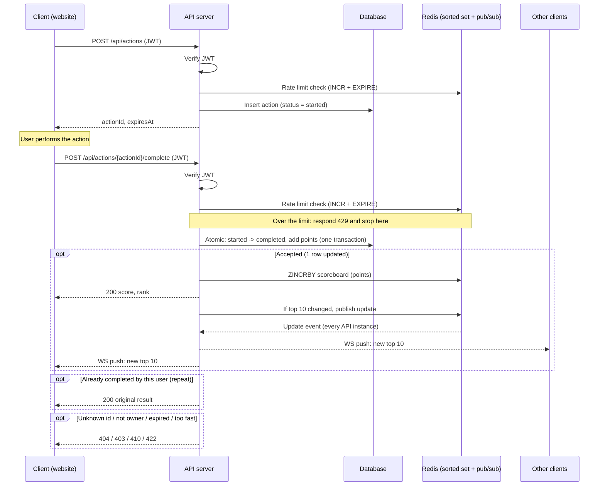

# Scoreboard Module Specification

Backend module that keeps user scores, protects them from tampering, and pushes live top-10 updates to the website. What the user's action actually is stays out of scope; we only need "completed an action" to be a trusted, one-time event.

## 1. Core security rule

**The client never sends a score.** It only says "I finished action X". The server decides the points, so a tampered request can't pick its own number.

Three checks protect the update:

1. **Authentication:** every request carries a valid JWT.
2. **One-time action id:** the server issues an `actionId` when the action starts, and completing it consumes it. A replay returns the original result; forged ids and other users' ids are rejected.
3. **Rate limit and minimum duration:** too many completions per minute, or finishing faster than the action can take, is rejected.

## 2. API

All endpoints require `Authorization: Bearer <jwt>` except the public read endpoint.

| Method | Path                              | Purpose                                                                                      |
| ------ | --------------------------------- | -------------------------------------------------------------------------------------------- |
| `POST` | `/api/actions`                    | Start an action. Returns `{ actionId, expiresAt }`.                                          |
| `POST` | `/api/actions/:actionId/complete` | Complete it. Server adds points and returns `{ score, rank }`.                               |
| `GET`  | `/api/scoreboard`                 | Current top 10: `[{ rank, userId, name, score }]`. Used for the first page load.             |
| `WS`   | `/ws/scoreboard`                  | Live feed. Server pushes `{ type: "scoreboard", top10: [...] }` whenever the top 10 changes. |

Errors:

| Status | When                                       |
| ------ | ------------------------------------------ |
| 401    | Missing or invalid JWT                     |
| 403    | `actionId` belongs to another user         |
| 404    | Unknown `actionId`                         |
| 410    | Action expired                             |
| 422    | Completed faster than the minimum duration |
| 429    | Rate limit exceeded                        |

Completing an action twice never adds points twice. A repeat by the same user returns `200` with the score saved at completion (`score_after`) and the current rank, so a retry after a network failure is safe and still gets its answer. The atomic state change in section 4 is what prevents the double count.

## 3. Execution flow



## 4. Data model

```
users    (id, name, score, updated_at)
actions  (id, user_id, status, points, score_after, created_at, expires_at, completed_at)
         status: started | completed
```

Completion is a single atomic statement, so concurrent or repeated requests can't double-count:

```sql
UPDATE actions
SET status = 'completed', completed_at = now()
WHERE id = :id AND user_id = :userId AND status = 'started' AND expires_at > now()
  AND created_at <= now() - :minDuration;
-- 0 rows affected -> look up why: already completed by this user -> return the stored result (200);
--                    otherwise return 404 / 403 / 410 / 422.
-- 1 row affected  -> UPDATE users SET score = score + :points RETURNING score, then save it in
--                    actions.score_after, all in the same transaction.
```

`points` is set by the server when the action starts. The client has no say in it.

## 5. Live update design

- The database is the source of truth. Redis holds a sorted set `scoreboard` (`ZINCRBY`, `ZRANGE scoreboard 0 9 REV`) so reading the top 10 is fast. `ZINCRBY` adds points atomically, so two fast completions can't overwrite each other.
- After each accepted completion the server compares the new top 10 with the last one and only publishes when it changed. This keeps traffic low.
- Every API instance subscribes to the Redis channel and forwards events to its own WebSocket clients, so it works with more than one server.
- On connect, a client first calls `GET /api/scoreboard`, then listens on the WebSocket. If the socket drops it reconnects and re-fetches.
- Server-Sent Events are a fine alternative to WebSocket: updates only go one way, and SSE is simpler to run behind proxies.

## 6. Implementation notes for the team

- Keep the transaction short: one row update on `actions`, one on `users`.
- Index `actions(user_id, status)` and `users(score DESC)`.
- Rate limits: per user and per IP, for example 10 completions per minute per user. Store counters in Redis.
- Log every completion with user, action, IP and result. It is the audit trail for investigating cheating.
- Rebuild the Redis sorted set from **all** rows of `users` on startup or if it is lost. Loading only the top 10 would break `ZINCRBY`: a user outside it would restart from 0.

## 7. Suggested improvements

- **Periodic rebuild:** if the server crashes after the database commit but before the Redis update, Redis falls behind. Rebuild the sorted set from `users` on a schedule to heal that drift.
- **Tiebreaker:** order equal scores by who reached them first, otherwise the board flickers.
- **Anomaly detection:** flag users whose score grows far faster than normal, and review or freeze them.
- **Signed action tokens:** sign `actionId` with a server secret so the server can reject forged ids before touching the database.
- **Action-specific proof:** if the action has a verifiable result (a game replay, a server-side check), validate it at completion. Without it, the minimum duration and rate limit are the only guards against a scripted client.
- **Leaderboard scope:** daily, weekly or all-time boards are easy with separate sorted sets.
- **Throttle pushes:** if scores change many times a second, batch WebSocket pushes to at most one per second.
- **Token refresh:** use short-lived JWTs with refresh tokens so a stolen token expires quickly.
